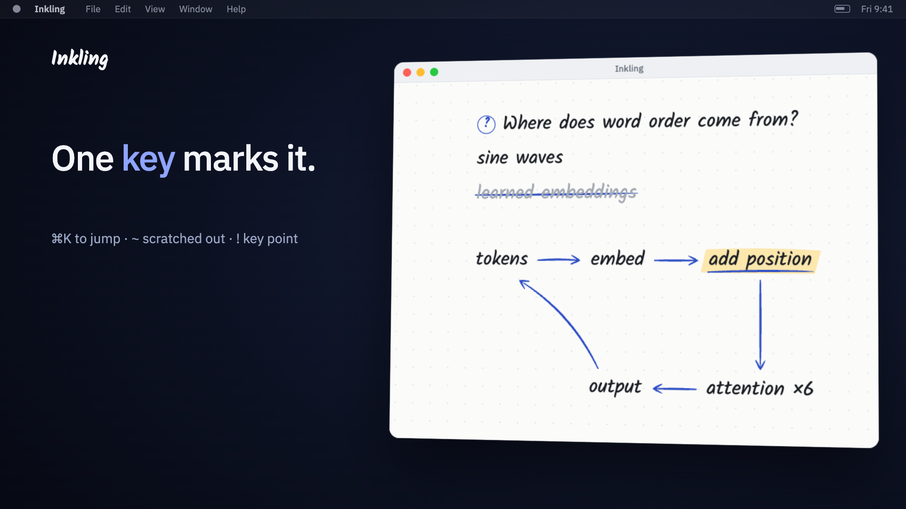

# Inkling

I wanted to do visual thinking on my desktop the way I used to on my iPad, so I made Inkling.

[](media/inkling-teaser.mp4)

## Build

```bash
npm install
npm start          # run it
npm run build      # makes dist/Inkling-<version>-arm64.dmg
```

Press ⌘⇧Space in any app to bring Inkling to the front. Inside, ⌘/ shows every key and ⌘, changes them.
